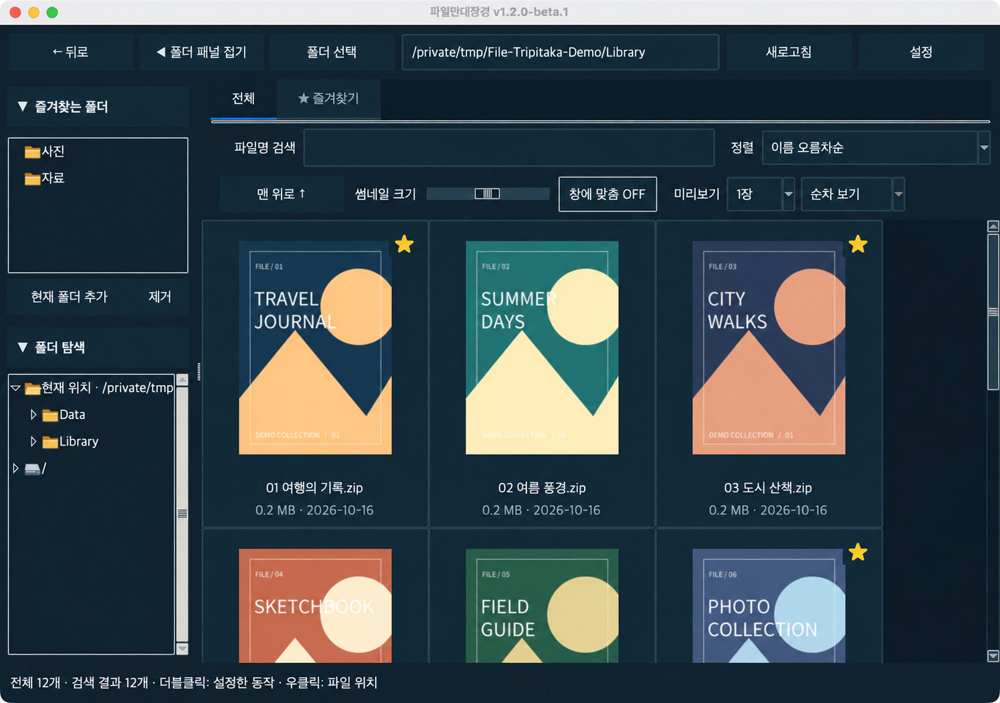

<p align="center">
  
</p>

<h1 align="center">파일만대장경 · File Tripitaka</h1>

<p align="center"><strong>압축파일 안의 사진을, 한눈에.</strong></p>

<p align="center">
  여러 폴더에 흩어진 압축파일을 썸네일로 훑어보고,<br>
  마음에 드는 파일을 모아 원하는 뷰어로 여는 Windows·macOS 프로그램입니다.
</p>

<p align="center">
  <a href="https://github.com/sin871220/File-Tripitaka/releases/tag/v1.2.0-beta.1"><strong>베타 다운로드</strong></a>
  &nbsp;·&nbsp;
  <a href="#처음-사용하기">사용 방법</a>
  &nbsp;·&nbsp;
  <a href="https://github.com/sin871220/File-Tripitaka/issues">오류 신고·기능 제안</a>
</p>

<p align="center"><sub>Archive thumbnail browser for Windows and macOS · 한국어 / English</sub></p>



*예시 자료를 사용한 Mac 베타 화면입니다. 개인 파일과 개인 폴더 이름은 포함하지 않았습니다.*

## 다운로드

**현재 소스 버전은 1.2.1입니다.** [1.2.1 업데이트 내역](BETA-RELEASE.md)에서 새 기능과 수정 사항을 확인할 수 있습니다. 아래 링크는 현재 공개된 **1.2.0-beta.1** 실행 파일이며, 1.2.1의 추가 기능은 포함하지 않습니다.

[v1.2.0-beta.1 다운로드 페이지](https://github.com/sin871220/File-Tripitaka/releases/tag/v1.2.0-beta.1)에서 내 컴퓨터에 맞는 ZIP을 받으세요. Python을 따로 설치할 필요가 없습니다.

이번 베타의 [Tcl/Tk 추가 고지문](https://github.com/sin871220/File-Tripitaka/releases/download/v1.2.0-beta.1/THIRD-PARTY-NOTICES.txt)도 함께 받아 앱 배포물과 보관해 주세요. 기존 앱 ZIP은 변경하지 않았습니다.

| 내 컴퓨터 | 받을 파일 | 실행 방법 |
|---|---|---|
| Windows 10/11 · 64비트 | [Windows-x64.zip](https://github.com/sin871220/File-Tripitaka/releases/download/v1.2.0-beta.1/File-Tripitaka-v1.2.0-beta.1-Windows-x64.zip) | 압축을 풀고 `FileManDaejanggyeong.exe` 실행 |
| Mac · Apple Silicon(M1 이상) | [macOS-arm64.zip](https://github.com/sin871220/File-Tripitaka/releases/download/v1.2.0-beta.1/File-Tripitaka-v1.2.0-beta.1-macOS-arm64.zip) | 압축을 풀고 `File Tripitaka.app`을 응용 프로그램 폴더로 이동 |
| Mac · Intel | [macOS-x86_64.zip](https://github.com/sin871220/File-Tripitaka/releases/download/v1.2.0-beta.1/File-Tripitaka-v1.2.0-beta.1-macOS-x86_64.zip) | 압축을 풀고 `File Tripitaka.app`을 응용 프로그램 폴더로 이동 |

Mac 버전은 **macOS 15 이상**을 지원합니다. Mac의 칩 종류는  → **이 Mac에 관하여**에서 확인할 수 있습니다.

현재는 **배포자 코드 서명·Apple 공증이 없는 베타**라서 운영체제의 실행 경고나 차단이 나타날 수 있습니다. 자세한 실행 조건은 [베타 안내](BETA-RELEASE.md)를 확인하세요. 이전 버전과 변경 사항은 [전체 Releases](https://github.com/sin871220/File-Tripitaka/releases)에 모아 둡니다.

## 이렇게 둘러보세요

| 기능 | 할 수 있는 일 |
|---|---|
| **폴더 전체를 한 화면에** | 선택한 폴더와 하위 폴더의 압축파일을 모아 보고, 파일명 검색과 이름·수정 날짜 정렬로 좁혀 갑니다. |
| **표지와 본문을 함께** | 기본 1장 보기에서 2장·3장 보기로 바꾸면 여러 이미지를 나란히 확인할 수 있습니다. |
| **파일별 즐겨찾기** | 폴더가 달라도 즐겨찾기 탭에서 한꺼번에 확인합니다. 전체 탭에서는 오른쪽 위 노란 별로 구분합니다. |
| **파일 정리** | 우클릭 메뉴와 F2로 이름을 바꾸고, Delete로 확인 후 휴지통에 보냅니다. 이름을 바꿔도 즐겨찾기를 유지합니다. |
| **끊김을 줄인 탐색** | 페이지를 넘기지 않고 계속 스크롤합니다. 화면 근처의 카드만 생성하며, 탭마다 스크롤 위치를 기억합니다. |
| **내 화면에 맞게** | 사이드바 접기, 창 너비 맞춤, 네 가지 테마와 글꼴·글자 크기, 카드 표시 항목을 설정합니다. |

## 처음 사용하기

1. **폴더 선택**을 눌러 압축파일이 있는 폴더를 고르세요. 하위 폴더까지 모아 보는 옵션은 기본으로 켜져 있습니다.
2. **전체** 탭에서 썸네일을 둘러보세요. 파일명으로 검색하거나 이름·수정 날짜 순으로 정렬할 수 있습니다.
3. 자주 찾는 파일은 **오른쪽 클릭 → 즐겨찾기 추가**로 모아 두세요. **즐겨찾기** 탭은 현재 폴더와 관계없이 모든 파일 즐겨찾기를 보여 줍니다.
4. **설정 → 열기 동작**에서 더블클릭 동작과 뷰어 경로를 고르세요. **설정 → 단축키**에서는 기능별로 키를 지정합니다. Windows에서는 꿀뷰나 다른 뷰어를, Mac에서는 기본 앱이나 다른 뷰어를 연결할 수 있습니다.

Mac의 기본 더블클릭 동작은 **Finder에서 파일 위치 열기**입니다. **기본 앱으로 열기**는 macOS의 파일 연결을 따르므로 압축 해제 프로그램이 열릴 수도 있습니다. 외부 뷰어와 Windows용 꿀뷰는 포함하지 않으며, 따로 설치해야 합니다.

### 마우스와 키보드

| 조작 | 동작 |
|---|---|
| 왼쪽 폴더 이름 한 번 클릭 | 해당 폴더의 썸네일 표시 |
| 폴더 탐색에서 더블클릭 / 화살표 클릭 | 하위 폴더 펼치기·접기 |
| 썸네일 한 번 클릭 → 방향키 | 파일 선택 후 그리드 안에서 이동 |
| 더블클릭 | 열기 동작에서 설정한 동작 실행 |
| Enter / Space 및 지정한 단축키 | 단축키 설정에서 해당 키에 지정된 기능 실행 |
| 오른쪽 클릭 | 파일 위치·즐겨찾기 등 메뉴 열기. Mac은 보조 클릭·Control-click도 지원 |
| 파일 선택 → F2 (기본값) | 압축파일 이름 변경. 확장자는 유지하며 같은 이름의 파일을 덮어쓰지 않음 |
| 파일 선택 → Delete (기본값) | 확인 후 원본 압축파일을 휴지통으로 이동. Mac은 Command+Backspace도 지원 |

기존 Enter·Space 동작은 기능별 단축키로 자동 이전합니다. 이전에 **없음**으로 설정한 키는 미할당으로 유지하고, 더블클릭 설정은 독립적으로 보관합니다. 즐겨찾기 탭에서 단축키로 해제하면 스크롤을 유지하며 다음 파일을 선택하고, 마지막 파일이면 이전 파일을 선택합니다.

### 기능별 단축키

**설정 → 단축키**에서 파일 위치 열기, 뷰어로 열기, 다른 뷰어로 열기, 즐겨찾기 추가/해제, 이름 바꾸기, 휴지통 이동, **폴더 패널 접기/펴기**, **창에 맞춤 ON/OFF**에 각각 키를 두 개까지 지정할 수 있습니다. 키 버튼을 누른 뒤 원하는 키 또는 Ctrl·Shift·Alt 조합을 누르세요. Mac은 Cmd 조합도 지원합니다.

폴더 패널과 창에 맞춤은 기본 단축키가 미할당이며 기존 설정에 새 항목만 추가됩니다. 두 기능은 썸네일을 클릭하지 않아도 메인 창의 폴더 탐색·즐겨찾는 폴더·버튼 등에서 사용할 수 있습니다. 파일 선택이 없거나 빈 폴더여도 동작하며, 검색·경로 입력·설정창에서는 입력을 가로채지 않습니다. 창에 맞춤은 기존 버튼과 똑같이 ON/OFF를 전환합니다.

- 다른 기능에 이미 할당한 키는 충돌 안내와 함께 거부하며 기존 할당을 덮어쓰지 않습니다.
- 할당 해제로 해당 칸을 비울 수 있습니다. 기본값 복원은 단축키만 초기화하고 더블클릭·테마·즐겨찾기는 유지합니다.
- 설정 변경과 기본값 복원은 **적용**을 누르면 저장됩니다. 취소하면 기존 설정을 유지합니다.
- 파일 작업 단축키는 썸네일 영역에 포커스가 있을 때 동작합니다. 폴더 패널·창 맞춤은 메인 창의 다른 영역에서도 사용할 수 있습니다. 검색창이나 이름 입력 중에는 파일 삭제·이름 변경을 실행하지 않습니다. 방향키·Tab·Esc 같은 기본 탐색 키는 보호합니다.

이름 변경과 삭제는 우클릭 메뉴에서도 사용할 수 있습니다. 삭제한 파일은 전체 목록과 즐겨찾기에서 함께 빠지며 다음 파일이 선택됩니다. 스크롤은 유지하고, 목록 끝에서는 남은 목록 높이에 맞춰 조정합니다. 휴지통을 사용할 수 없는 위치에서는 삭제하지 않습니다. 휴지통에서 복원한 파일은 **새로고침**으로 다시 불러올 수 있으며, 즐겨찾기는 다시 추가해야 합니다.

이름 변경창은 **원래 파일명이 한 줄에 들어오도록 너비를 자동으로 맞추며**, 화면보다 긴 이름은 줄바꿈합니다. 원래 이름은 드래그 선택·복사가 가능한 읽기 전용입니다. 창 크기는 직접 조절할 수 있고, 새 이름 입력칸과 버튼이 가려지지 않도록 최소 크기를 적용합니다.

### 1장·2장·3장 미리보기

기본은 **1장 보기**입니다. 2장·3장 보기는 카드의 폭을 넓혀 이미지를 작은 간격으로 나란히 배치합니다.

| 선택 | 순차 보기에서 고르는 이미지 | 비율 보기에서 고르는 이미지 | 화면의 왼쪽 → 오른쪽 |
|---|---|---|---|
| 1장 | 맨 앞 | 맨 앞 | `1` |
| 2장 | 1·2번째 | 맨 앞 · 1/2 위치 | `2 → 1` |
| 3장 | 1·2·3번째 | 맨 앞 · 1/3 · 2/3 위치 | `3 → 2 → 1` |

화면 순서의 숫자는 선택된 이미지의 순서입니다. 맨 앞 이미지가 오른쪽에 옵니다. 이미지가 부족하면 실제 장수만 표시하고 같은 이미지를 중복하지 않습니다.

### 화면 꾸미기

- **창에 맞춤 ON/OFF:** 현재 4열이면 4열, 5열이면 5열을 유지하면서 창 너비를 채웁니다. 슬라이더를 움직이면 OFF로 돌아옵니다.
- **폴더 패널 접기:** 사이드바 전체를 접어 썸네일 영역을 넓힙니다. 즐겨찾는 폴더와 폴더 탐색도 각각 접을 수 있습니다.
- **테마:** 라이트 · 다크 · 네이비 · 블루.
- **카드 표시:** 파일명, 확장자, 용량, 수정 날짜 중 필요한 항목만 표시합니다.
- **글꼴·언어:** 글꼴과 글자 크기를 바꾸고, 한국어 / English를 선택할 수 있습니다. 제목·메뉴·설정이 함께 바뀌며 파일명은 그대로 유지합니다.
- **대화상자 위치:** 설정창은 메인 창 중앙에, 단축키 할당·이름 변경창은 부모 창 중앙에 열립니다. Windows에서는 해당 모니터의 작업 영역 안으로 위치를 조정합니다.

## 어떤 파일을 볼 수 있나요?

| 종류 | 지원 |
|---|---|
| 압축파일 | ZIP · CBZ 기본 지원 / RAR · CBR · 7Z · CB7은 별도 7-Zip 필요 |
| 압축파일 안의 이미지 | JPG · JPEG · PNG · WebP · BMP · GIF · TIFF |

**7-Zip은 배포 파일에 포함하지 않습니다.** 설치된 `7z`·`7zz`를 PATH와 일반적인 설치 경로에서 찾으며 Mac의 Homebrew 경로도 확인합니다. 내부 이미지 이름은 자연 정렬합니다.

암호가 걸렸거나 손상·분할·중첩된 압축파일은 미리보기가 제한될 수 있습니다. 미리보기를 만들 수 없는 파일은 파일 위치를 열어 직접 확인할 수 있습니다. 미리보기는 원본을 수정하지 않습니다. **이름 변경·삭제를 직접 실행하면 원본 압축파일의 이름이 바뀌거나 휴지통으로 이동합니다.** 즐겨찾기는 파일 경로 기준으로 저장하며 앱 안에서 이름을 변경하면 새 경로를 반영합니다.

## 문제를 발견했나요?

[Issues](https://github.com/sin871220/File-Tripitaka/issues)에 **운영체제 버전, Mac 칩 종류 또는 Windows CPU, 파일 형식, 문제가 생긴 순서**를 적어 주세요. 화면을 첨부한다면 개인 이미지와 민감한 경로는 가려 주세요.

<details>
<summary><strong>설정·캐시·로그 위치와 미리보기 제한</strong></summary>

| 운영체제 | 저장 위치 |
|---|---|
| Windows | `%LOCALAPPDATA%\ArchiveShelf` |
| macOS | `~/Library/Application Support/File Tripitaka` |

`settings.json`에는 설정과 즐겨찾기, `cache/`에는 썸네일이 저장됩니다. 오류를 살펴볼 때는 `error.log`와 `crash.log`를 확인하세요. 로그를 공개하기 전에는 개인 경로와 민감한 내용이 들어 있는지 확인해 주세요.

Mac에서 이전 소스 실행으로 만든 `~/.local/share/ArchiveShelf/settings.json`이 있으면 새 저장 위치로 한 번 가져옵니다. Windows의 기존 설정 위치는 유지합니다. Windows에서 언어를 바꾸면 현재 EXE를 가리키는 기존 바탕화면 바로가기 이름도 변경합니다.

대표 이미지 데이터는 압축 해제 후 64MB까지 처리합니다. 큰 이미지 디코더는 별도 프로세스에서 한 장씩 실행하며 메모리(RSS 512MB)와 시간(45초) 제한을 적용합니다. 미리보기 실패 항목은 설정한 열기 동작 대신 파일 위치를 엽니다. **없음·즐겨찾기 전환**은 예외입니다.

</details>

<details>
<summary><strong>소스로 실행하거나 직접 빌드하기</strong></summary>

Python 3.12 이상과 Tcl/Tk가 필요합니다.

```sh
python -m pip install -r requirements.txt
python app.py
```

Windows 소스 실행은 **새 버전 ZIP을 새 폴더에 전부 푼 뒤 그 폴더의 `run-windows.bat`**을 실행하세요. 실행 창에 실제 소스 폴더와 버전이 표시됩니다. 공유폴더(UNC 경로)도 지원하며, 실행 준비에 실패하면 다른 버전으로 넘어가지 않고 오류를 표시합니다.

공유폴더를 통해 다른 Windows 컴퓨터로 옮겨 테스트할 때는 `python scripts/package_windows_test.py`로 **Windows-Test.zip 하나**를 만들 수 있습니다. 코드·아이콘·글꼴과 실행 배치가 한 버전 폴더에 들어가며, Git 미추적 신규 모듈도 포함합니다. ZIP 전체를 옮겨 새 폴더에 푼 뒤 그 안의 배치를 실행하세요. 이 테스트 ZIP에는 Python이나 EXE가 포함되지 않습니다.

- Windows: 소스 실행은 `run-windows.bat`, 배포 빌드는 `build-windows.bat`.
- macOS: `build-macos.sh`. Apple Silicon과 Intel은 해당 CPU용 Python 환경에서 각각 빌드합니다.
- GitHub Actions: 베타 태그를 푸시하면 Windows·Mac의 테스트, 빌드, 패키징 점검을 통과한 파일을 prerelease로 배포합니다. 수동 실행은 빌드 산출물을 만듭니다.

```sh
python -m unittest discover -s tests -v
python tests/gui_smoke.py
python tests/language_smoke.py
python tests/file_actions_smoke.py
python tests/shortcuts_smoke.py
```

패키징된 앱은 `--self-test --report <JSON 경로>`로 ZIP 처리·네이티브 디코더·Tk GUI·언어 전환을 점검할 수 있습니다. 자동 점검이 모든 기기에서의 실사용 검증을 대신하지는 않습니다.

</details>

<details>
<summary><strong>포함 자료와 고지</strong></summary>

- 앱 아이콘: `assets/app.png`. Windows용 `assets/app.ico`를 포함하며 Mac 아이콘은 같은 이미지로 빌드합니다.
- Noto Sans CJK KR 글꼴: `fonts/SOURCE.txt`에 출처, `fonts/OFL.txt`에 라이선스를 포함합니다.
- 배포 패키지에는 사용한 라이브러리 버전과 이용 가능한 라이선스 고지문을 함께 담습니다.

</details>
